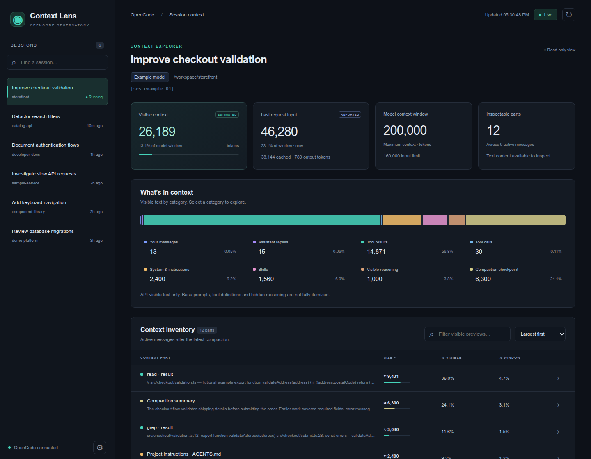

# OpenCode Context Lens

A local, interactive dashboard for **OpenCode V2** sessions: active context parts,
estimated tokens and percentages, provider-reported request usage, session search,
category filtering, grouped inventory, waste signals, timeline/diff, run-only pins,
reviewed runtime summaries, durable manual pruning, and native Desktop V2 pruning controls. Refreshes automatically; polling can be paused. Session
links can be bookmarked.



*Example interface with entirely fictional sessions, paths, and message content.*

## Run

Requires Python 3.11+, [uv](https://docs.astral.sh/uv/), and OpenCode V2.

```sh
./run.sh
```

The script installs dependencies through `uv` and starts the server. It also works
when invoked from another directory.

Open **http://127.0.0.1:9193**. The port defaults to **9193** and is configurable via
`port` in `settings.yaml`; restart the server after changing it.

The dashboard reads OpenCode through its authenticated
`opencode api` command, using the same managed service as the CLI. OpenCode may start
its service automatically. The viewer does not modify sessions or read the database.

## Settings

Copy `settings.example.yaml` to `settings.yaml` for local overrides, then restart.
Local settings are ignored by Git; defaults apply when the file is absent.

```yaml
opencode_path: null                  # PATH, then ~/.opencode/bin/opencode
opencode_server: null                # Optional explicit HTTP(S) server
host: 127.0.0.1
port: 9193                          # Configurable dashboard port
refresh_seconds: 5
request_timeout_seconds: 30
history_sessions: 8
history_snapshots_per_session: 32
history_max_bytes: 67108864
```

`opencode_path` accepts an executable, a `bin` directory, or an installation directory
(for example `~/.opencode`). Relative paths resolve beside the settings file. If the
file is absent, defaults apply. Use another file with
`./run.sh --settings /path/to/settings.yaml`.

## Reading the numbers

- **Visible context:** text from the active-context API, including retained
  compaction summaries, messages, tool calls/results, skills and visible reasoning.
  Per-part token sizes use `o200k_base` as an estimate for every model. Percentages
  show share of visible text and share of the model’s context window.
- **Last request input:** provider-reported uncached input + cache reads + cache
  writes for the latest completed assistant request in active context. This is
  a previous request’s measurement, not cumulative session usage or a live total.
- **Visibility limits:** the API does not itemize the base system prompt, tool
  definitions, protocol overhead, media tokens or encrypted reasoning. These are
  not fabricated as text tokens. Unknown sizes are marked explicitly. The visible
  estimate and reported request total have different scopes and may differ.
- The tokenizer downloads its encoding on first use and caches it locally. If
  unavailable, the UI identifies the fallback UTF-8-bytes/4 estimate. Model limits
  are read from OpenCode; unavailable limits are shown as unknown.

Context summaries are cached for one refresh interval, for up to eight sessions.
Full part content is loaded into the browser only when inspected. An open inspector
keeps its original snapshot while monitoring continues.

## Reviewing context

- Switch the inventory between **flat**, **tool**, **resource**, and **retained turn**
  views. Expand groups to inspect members. Filters adjust group totals; percentages
  still use the full snapshot. Resource groups use literal declared paths.
- **Review opportunities** flags exact repeated results, reads with identical
  arguments, and results of at least 4,096 estimated tokens. Open the evidence to
  compare occurrences. Repeated reads may contain changed content; a finding does
  not prove that content is unnecessary.
- Select a finding or inventory member to include its **complete tool invocation**,
  including paired parts hidden by filters. Group selection skips ineligible units.
  Failed, unfinished, instruction-bearing, and unknown-size units explain why they
  cannot enter a numeric preview.
- **Cleanup preview** shows unique selected tokens and estimated remaining visible
  context. Overlapping selections count once. It is hypothetical: no context changes,
  and reported provider usage remains unchanged. Unmeasured content stays disclosed.
- Same-revision refreshes preserve selection. A changed snapshot or session clears it.
  Pause live updates to review a snapshot; if it is evicted from cache, refresh and
  reselect. Selections are not saved across browser reloads.

### History, protection, and selection

- Timeline captures successful refreshes during this dashboard run. Identical
  consecutive revisions share an observation. Capture gaps, compaction markers,
  category totals, unknown sizes, and eviction counts remain visible.
- Compare retained observations in either direction; inspect removed content from
  its original snapshot. History/diff views are inspection-only. **Return to live
  context** restores action controls.
- History defaults to 8 sessions, 32 observations/session, and 64 MiB of accounted
  payload. Oversized captures are skipped, never truncated. This is not a total
  process-memory limit. Restart clears history, pins, and review drafts.
- **Select all tool calls and results** covers every eligible unpinned invocation
  in the displayed snapshot, including collapsed/unrendered rows. **Select matching**
  respects filters and includes complete paired inputs/results. Selection is a union;
  repeat clicks do not duplicate it. Pinned and ineligible skip counts are separate.
- Pinning either side protects the whole invocation. Other parts have part-only
  pins. Pins survive browser reload and history eviction; ambiguous/missing sources
  become unresolved. Protection governs Lens actions, not native compaction or other
  clients. Pinning an active replacement first deactivates its entire bundle.

### Install the companion plugin

Manual drafts and previews work without the plugin. Generation and activation need
the companion plugin in the **target session's location**. Install the server plugin
with `/lens-prune` terminal and Desktop extensions:

```sh
./install.sh
# Or select a specific global/project configuration:
./install.sh --config /path/to/opencode.jsonc
```

Requires npm; downloads Node 26.4 if the current Node is older. The default target is
`$OPENCODE_CONFIG_DIR`, otherwise `${XDG_CONFIG_HOME:-$HOME/.config}/opencode`: existing
`opencode.jsonc`, then existing `opencode.json`, otherwise a new JSONC file.
The installer enables `manualPruning`, preserves compaction settings, unrelated
plugins/options and JSONC comments, and backs up changed configuration beside the file.
It stages/builds a standalone package before publishing `context-lens/current` beside
the resolved configuration file. Reinstallation replaces that symlink; previous
releases remain under `context-lens/releases`. A failed preparation preserves the
previous installation.

Run `/lens-prune help` in Terminal or Desktop. OpenCode watches configuration and
local GUI bundles; the installer does not restart the service. To load directly from this checkout,
build with Node 26.4+ (`npm --prefix plugin ci` then `npm --prefix plugin run build`)
and register its absolute directory:

```json
{"$schema":"https://opencode.ai/config.json","plugins":["/absolute/path/opencode-context-lens/plugin"]}
```

### Reviewed tool summaries

Select complete calls, **Write summaries** or explicitly **Generate draft**, edit,
save, and **Preview summaries**. Only **Activate reviewed summaries** registers a
replacement. Generated text never activates automatically. Inputs include only the
selected tools' names, arguments, and visible results; no tools are executed for
generation. Actual generation usage/cost is unavailable.

Original API context, cumulative Lens projection, plugin registration, hook-observed
application, and provider usage are separate measurements. The preview counts the
attribution wrapper and can show negative savings. Stored history stays intact.

Qualified profile: **plain-text OpenAI-compatible HTTP full replay**, including tool
continuations. There is **no OpenCode-version admission gate**; host versions are
informational. Current isolated qualification uses SDK/plugin **2.2.5**, including the
experimental Desktop GUI API; earlier verification used **2.1.2** and **2.0.25**. Provider-native checkpoints, opaque provider state,
media, WebSocket/continuation profiles and raw model/provider body overrides remain
unavailable for activation. The isolated qualification command below records
outgoing requests, selected-source generation, profile refusal, and host restart.

Controls are run-only: 4,096 pins; 32 drafts/16 MiB; 64 active bundles/16 MiB.
Bundles select at most 128 units. Summaries are limited to 16 KiB/unit and 48 KiB
combined; serialized control requests to 64 KiB. Generation permits one job/session,
four/run, a 1 MiB prompt and 75% of known model capacity, with a 120-second deadline.
Inactive drafts and terminal records expire after 30 minutes. Nothing is truncated
to fit. Open the dashboard using its configured host/port; state actions validate
Origin/Host and accept JSON only.

The dashboard renews 45-second plugin leases every 15 seconds, even with browsing
paused or closed. **Deactivate** restores originals on later primary requests;
already assembled requests cannot be recalled. Rollback: deactivate, stop the
dashboard, and remove the plugin configuration. Remaining leases expire within
45 seconds without renewal. Plugin/dashboard restart requires fresh review; later
conversation is never rolled back.

### Durable manual pruning

The installer enables manual pruning. For a checkout-based installation, enable it
in the target location's OpenCode configuration:

```json
{
  "$schema": "https://opencode.ai/config.json",
  "plugins": [{
    "package": "/absolute/path/opencode-context-lens/plugin",
    "options": { "manualPruning": true }
  }]
}
```

In **Manual context pruning**, choose an action, select items individually or with
**Select all eligible / Select matching**, then **Preview pruning → Apply reviewed
pruning**. Bulk actions include unrendered items; the pruning panel has its own filter.

- **Prune tool output** keeps the call/arguments and replaces its text results with
  `[Output pruned]`.
- **Remove reasoning** omits selected visible reasoning parts.
- **Delete complete invocation** omits its call and results, plus associated reasoning
  disclosed in the preview. Other calls and assistant text remain in order.
- **Select large matching calls** selects calls above an adjustable argument + output
  UTF-8 byte threshold (default 16 KiB), including unrendered matches.
- **Remove conversation range** uses inclusive first/last message boundaries, removing
  user/assistant text and complete tool pairs within them.
- **Summarize range · brief / full** generates a short (~200-word target) or detailed
  summary using the current session model. Review it before applying; one labeled
  historical summary replaces the range. These summaries share durable edit/restore
  behavior, rather than the tool-summary panel's renewable leases.
- **Saved edits and restoration → Restore** reverses an entire reviewed edit group.
  Restore overlapping edits before choosing a different action or pinning that content.

Edits are saved through OpenCode's plugin storage, scoped to the session, and replayed
on subsequent supported primary requests, tool continuations, and transient session
generation and native summary-compaction input. They survive dashboard and host
restarts independently of summary leases until compaction succeeds.
Later conversation is included automatically. Original history stays intact; main
metrics show original API context and pruning estimates cover selected visible text
only. Hook observations are not provider-verified token savings.

Use the **plain-text OpenAI-compatible HTTP full-replay profile** described above.
New edits require an idle session. Source drift, native undo, changed model/location,
unsupported provider state, or invalid saved policy blocks affected requests instead
of silently sending originals. Restore and review again after such changes.
Auxiliary title generation keeps the existing title while edits are active.
**You can keep native auto-compaction enabled.** After successful automatic or manual
compaction, Lens clears saved edits, invalidates old previews, retires leased summaries
and cancels obsolete generation work. Fresh reviews belong to the new checkpoint.
Failed/interrupted compaction keeps the edits. Pruning applies to the context supplied
for summarization (the full context in 2.1.2/2.2.5; an older prefix in 2.0.25).
OpenCode owns retained recent content, which can include previously pruned material
after the reset. Old edit groups cannot be restored after reset; review new tool calls
and reasoning as the conversation continues. Missed completion events are reconciled
from the durable checkpoint after restart. Compaction must use the same qualified
model; opaque provider-native checkpoints remain unsupported.
Tool-summary generation/activation cannot overlap edited assistant messages. Range
summaries reject overlapping edits; concurrent source/policy/pin changes invalidate
their preview. Range selection rejects the whole range if it includes instructions,
checkpoints, media/attachments, unfinished/failed tools, or opaque provider state.

Pins remain dashboard-run scoped and are mirrored to the plugin on 45-second leases,
renewed every 15 seconds. Saved edits have no lease. Previews expire after five minutes
and are bound to source, policy revision, plugin instance, run, and live protection.
Limits: 512 selected targets/preview, 1 MiB exact preview, 64 pending previews/plugin,
4,096 saved targets/session, 128 recent operation receipts/session, and 64 KiB control
requests. Failed saves preserve the prior policy. Lens serializes its controls, but
does not lock arbitrary OpenCode clients or recall already dispatched requests.
Range generation has a two-minute deadline, four concurrent jobs, a 1 MiB/conservative
model-capacity input bound, and 16/48 KiB brief/full output bounds; no silent truncation.

### OpenCode Desktop V2

The installed `./gui-experimental` bundle adds **Open Context Lens** to the command
palette and **Context Lens** to the session side panel's **+** menu. It also registers
`/lens-prune` with the same arguments as Terminal. Enable its GUI under
**Settings → Extensions → Plugins** on Desktop's own server; global installation
makes it available across windows. Desktop must provide the experimental public GUI API.

The panel offers inventory/status, tool/output/reasoning/large-call previews,
inclusive range removal and brief/full summary generation. Use its **Lens command**
field for filtering, custom thresholds, `apply PREVIEW_ID`, or `restore GROUP_ID|all`.
Full `/lens-prune …` commands can also be pasted. Reports remain literal text in the
panel and never enter conversation/model context. Closing the panel does not apply.

Actions use the selected session's authenticated server and location, including
remote servers. Install the Lens server component there too; a missing backend or
unsupported provider produces an error. No separate dashboard process is needed for
native controls. The external dashboard remains available and must target the same
server if used alongside Desktop.

Panel and slash commands share a window run, so preview in one and apply in the other.
Reports are window-local (up to eight server/session entries); reloading the GUI requires
a fresh preview. Saved edits remain durable. Qualification exercises the shipped bundle
in a synthetic browser shell and its command through isolated SDK RPC; interactive
Electron Desktop and your connected server are not yet verified.

### OpenCode command

The companion registers `/lens-prune` in Terminal (`./tui`) and Desktop
(`./gui-experimental`). Commands **preview by default**; add `--apply` to commit
immediately. Reports appear in terminal dialogs or the Desktop Lens panel; closing
a report does not apply changes or send its contents to the model.

```text
/lens-prune list messages
/lens-prune list tools
/lens-prune tools read
/lens-prune tools all --outputs
/lens-prune large 16384 --apply
/lens-prune reasoning
/lens-prune range FIRST_MESSAGE_ID LAST_MESSAGE_ID
/lens-prune summarize brief FIRST_MESSAGE_ID LAST_MESSAGE_ID
/lens-prune summarize full FIRST_MESSAGE_ID LAST_MESSAGE_ID --apply
/lens-prune apply PREVIEW_ID
/lens-prune status
/lens-prune restore GROUP_ID
/lens-prune restore all
```

Use message IDs from `list messages` for inclusive boundaries. `tools` and `large`
delete complete invocations; `--outputs` retains calls/arguments. `tools` also accepts
`--min-bytes N`. Preview reports include before/after content and the apply command;
they expire after five minutes or a plugin restart. Pins and the same source guards
apply to both dashboard and commands. `/lens-prune help` lists the syntax.

Rollback: restore saved groups, then remove `manualPruning` or the plugin configuration.
Turning off `manualPruning` prevents new edits while continuing saved-policy enforcement.
Disabling/unloading the plugin leaves policies stored but unapplied, so OpenCode uses
its native context again. Forks/child sessions do not inherit policies. Later plugins
can change requests; qualify their ordering separately.

## Checks

Plugin checks require Node 26.4+; `install.sh` bootstraps it automatically.

```sh
npm --prefix plugin run build
npm --prefix plugin test
npm --prefix plugin run qualify  # Node 26.4+, isolated host and recording mock provider
node plugin/check-gui.mjs --check # Installed-bundle/main-process loading boundary
uv run python tests/installer_check.py  # Node 26.4+ on PATH; real installs into temporary config
uv run pytest
uv run ruff check .
node --check viewer/static/app.js
node --check viewer/static/review.js
node --check viewer/static/summary.js
node --check viewer/static/pruning.js
```

Synthetic end-to-end checks (requires Chrome; never connects to OpenCode):

```sh
uv run --with playwright python tests/browser_analysis_check.py
uv run --with playwright python tests/browser_review_check.py
uv run --with playwright python tests/browser_pruning_check.py
uv run python tests/cli_rpc_check.py  # installed CLI against a loopback fixture
```

Desktop bundle rendering and interaction (synthetic shell, no live OpenCode):

```sh
(cd plugin && npx vite build --config qualification/desktop.vite.ts)
uv run --with playwright python tests/browser_desktop_check.py
```
